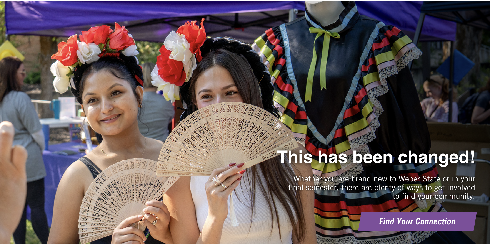
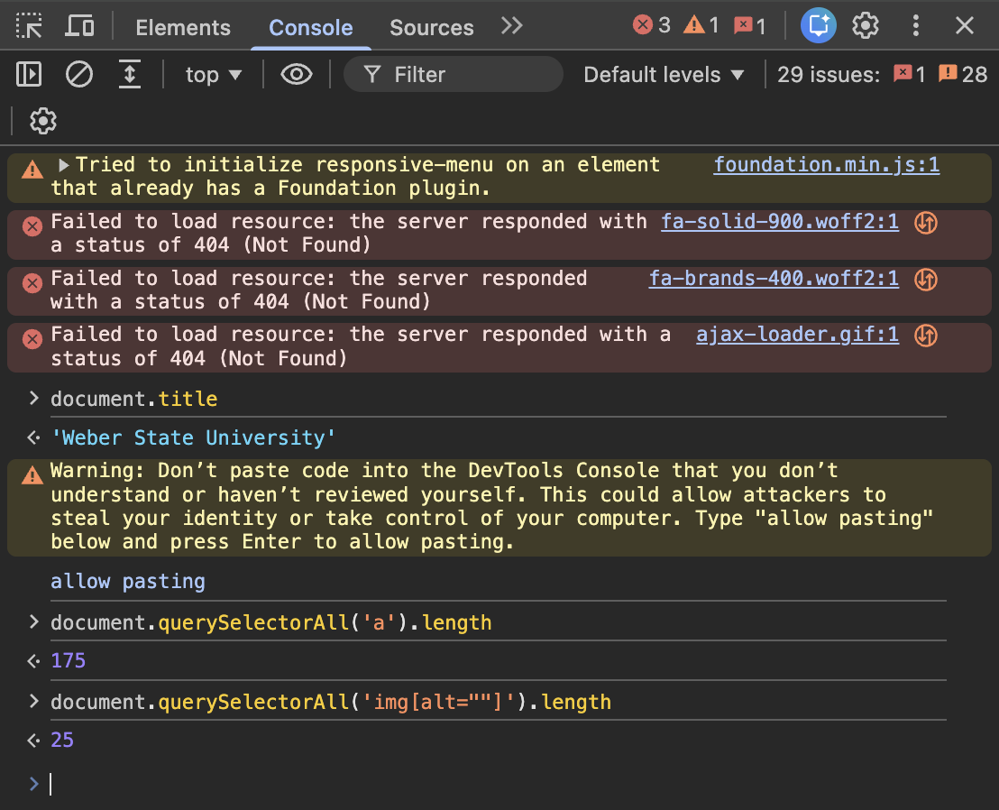
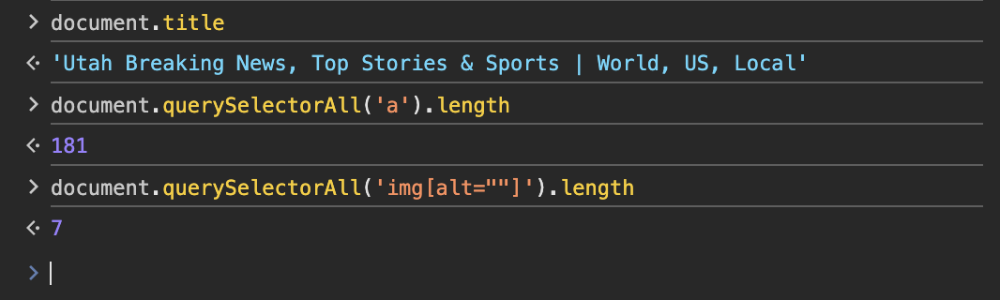
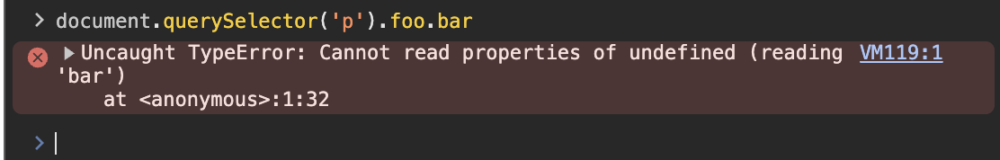

# Lab 01 – Inspection Notes

## Site 1: [https://www.weber.edu/]()

### Elements found (5)

| Tag | Semantic? | Purpose |
|-----|-----------|---------|
| `<script>` | No. | Used to link a script to the page. |
| `<link>` | No. | Links images or stylesheets. |
| `<meta>` | No. | Provides metadata for the page. |
| `<webchat-widget>` | Yes. | Sets up the chat widget. |
| `<table>` | Yes. | Organizes the provided data into rows and columns. |

### Live text edit

I changed an `<h2>` tag from "Welcome, Wildcats!" to "This has been changed!".

### Page structure
- `<main>` present? Yes.
- `<h1>` present? Yes.
- `<nav>` present? Yes.
- Images with `alt` attributes? Yes.

### Console results

| Expression | Result | What it tells you |
|-----------|--------|------------------|
| `document.title` |'Weber State University' | The title of the document. |
| `document.querySelectorAll('a').length` | 175 | Counts the number of <a> elements. |
| `document.querySelectorAll('img[alt=""]').length` | 25 | Counts the number of images that have no alternative text. |

### Network: first request

- URL: [https://www.weber.edu/]()
- HTTP method: GET
- Status code: 200 OK
- Content-Type: text/html; charset=utf-8
- Total page requests (approx): 122
- Total page weight: 7.9 MB

---

## Site 2: [https://www.ksl.com/]()

### Elements found (5)

| Tag | Semantic? | Purpose |
|-----|-----------|---------|
| `<iframe>` | No. | Embeds a document or website into a page. |
| `` | Yes. | Used for placing images on the page. |
| `
` | No. | Creates a generic container. |
| `<noscript>` | Yes. | Displays alternative content when a script isn't available or allowed. |
| `<body>` | Yes. | Creates a container for content. |

### Console results

| Expression | Result | What it tells you |
|-----------|--------|------------------|
| `document.title` | 'Utah Breaking News, Top Stories & Sports \ World, US, Local' | The title of the document. |
| `document.querySelectorAll('a').length` | 181 | Counts the number of <a> elements. |
| `document.querySelectorAll('img[alt=""]').length` | 7 | Counts the number of images that have no alternative text. |

### Network: first request

- URL: https://www.ksl.com/
- HTTP method: GET
- Status code: 200 OK
- Content-Type: text/html; charset=UTF-8

---

## My page (lab00/index.html)

- `document.querySelector('h1').textContent` returned: 'WEB 1430 – Lab 00'
- TypeError produced by: `document.querySelector('p').foo.bar` 
- Error message text: Uncaught TypeError: Cannot read properties of undefined (reading 'bar')
    at <anonymous>:1:32 
- What the error message tells you: It tells me that the console doesn't know what "bar" means.

---

## Reflection

What surprised you? What does DevTools tell you that you couldn't learn by just looking at the page?

It surprised me to see how many requests ksl.com made. There were over 1500. DevTools can tell you what the DOM actually looks like, the errors that might have occurred, how the page actually loads, and other things. It provides insight into how the webpage actually functions. 
