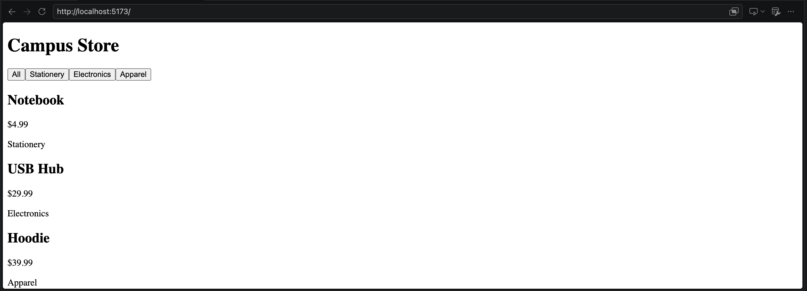

# Process Reflection

The original bundle relied on the products array and the activeCategory variable. I handled the products array by exporting it from `data.js` and importing it to `main.js`. I handled activeCategory by changing the `renderAll()` function to `renderGrid()` that passes in the filtered product list within `buildFilter()` without needing to track the active category globally. 

Removing `export` from the products array gives me an error that says the resource failed to load, and that the server responded with a status of 403. 

The `dist/` folder contains an optimized version of your code that is minified and bundled. It allows others to be able to run your app. Other people cannot see your project outside your local machine otherwise. 

## Screenshot

