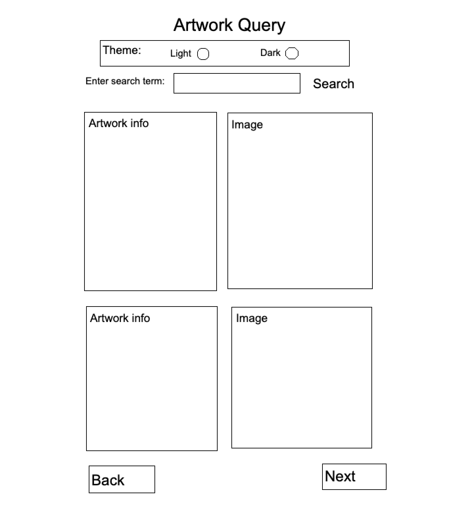

# Final Project Pitch: Artwork Query

[API reference website](https://api.artic.edu/docs/#introduction)

1. This app will fetch and display artwork for art enthusiasts.
2. It can be difficult to search for artwork based on a specific query. This app will allow art enthusiasts in the community to easily search for artwork that relates specific search terms and display the results in an organized format.
3. Feature list:
- Search for artwork.
- Select a preferred theme (light or dark).
- Load the next page of results.
4. API & Data Source:
- API call for general info: `https://api.artic.edu/api/v1/artworks/search?q=picasso&limit=1&fields=id,image_id,title,artist_display,date_start,short_description,thumbnail`
- API call for the image: `https://www.artic.edu/iiif/2/{identifier}/full/843,/0/default.jpg`
- Response:
```
{
  "preference": null,
  "pagination": {
    "total": 133375,
    "limit": 1,
    "offset": 0,
    "total_pages": 133375,
    "current_page": 1
  },
  "data": [
    {
      "_score": 100.1679,
      "id": 28067,
      "title": "The Old Guitarist",
      "thumbnail": {
        "lqip": "data:image/gif;base64,R0lGODlhAwAFAPMAAC84OzA3NzU4NTI5Ois9TTdAQj9JRjhGTD9MSzxKTD5MT0BNS0VaYURaY1FnbgAAACH5BAAAAAAALAAAAAADAAUAAAQL0DXQTiBLKDNQKhEAOw==",
        "width": 10727,
        "height": 15979,
        "alt_text": "Painting, mostly in shades of blue, of a thin, bent, older man wearing ragged clothes and sitting cross-legged playing a guitar positioned upright in his lap."
      },
      "date_start": 1903,
      "artist_display": "Pablo Picasso\nSpanish, active France, 1881–1973",
      "short_description": "This famous work is from Picasso’s Blue Period (1901–04), a time the artist restricted himself to a cold, monochromatic blue palette and flattened forms to convey the themes of misery and alienation. The elongated figure also reflects his interest in the great 16th-century Spanish artist El Greco. The 22-year-old Picasso had sympathy for the downtrodden; at the time, knew what it meant to be penniless.",
      "image_id": "4e7f3081-179a-af18-8abd-7908a7ae8c4e"
    }
  ],
  "info": {
    "license_text": "The `description` field in this response is licensed under a Creative Commons Attribution 4.0 Generic License (CC-By) and the Terms and Conditions of artic.edu. All other data in this response is licensed under a Creative Commons Zero (CC0) 1.0 designation and the Terms and Conditions of artic.edu.",
    "license_links": [
      "https://creativecommons.org/publicdomain/zero/1.0/",
      "https://www.artic.edu/terms"
    ],
    "version": "1.16"
  },
  "config": {
    "iiif_url": "https://www.artic.edu/iiif/2",
    "website_url": "https://www.artic.edu"
  }
}
```
5. Vue with the above API.
6. Sketch:



7. Data starter:
- Object:
```
{
    id: 28067,
    imageId: 4e7f3081-179a-af18-8abd-7908a7ae8c4e,
    caption: "Pablo Picasso. The Old Guitarist, 1903. The Art Institute of Chicago.",
    alt: "Painting, mostly in shades of blue, of a thin, bent, older man wearing ragged clothes and sitting cross-legged playing a guitar positioned upright in his lap."
}
```
- I will store the user's preference for the theme of the page (light or dark).
8. API viability check:
- CORS: The API supports cross-origin requests.
- Rate limits/auth: 60 requests per minute, no authentication required.
- Attribution: Attribution is generally not required, but a preferred caption format is requested (shown above).
- Data reliability: The data appears to be reliable and comes in the same format when requested. 