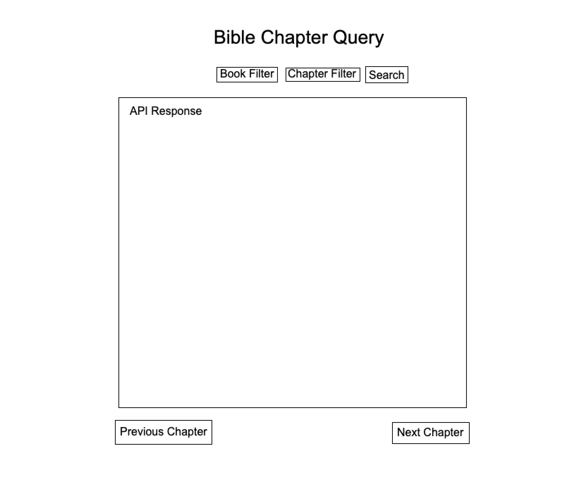
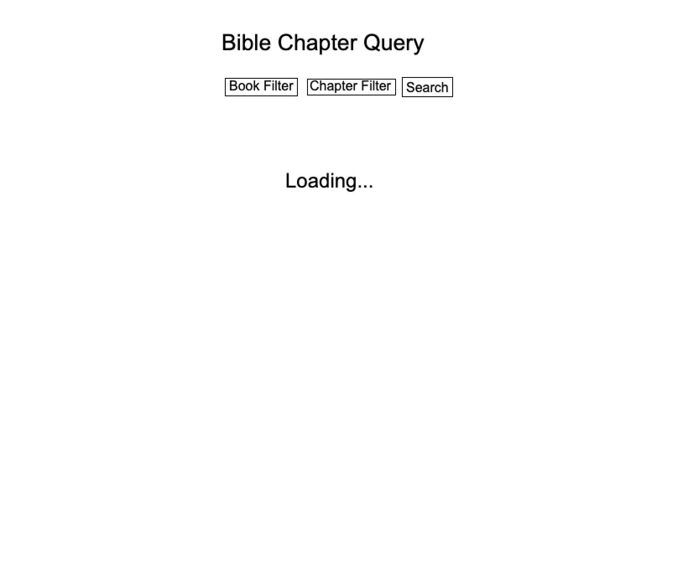
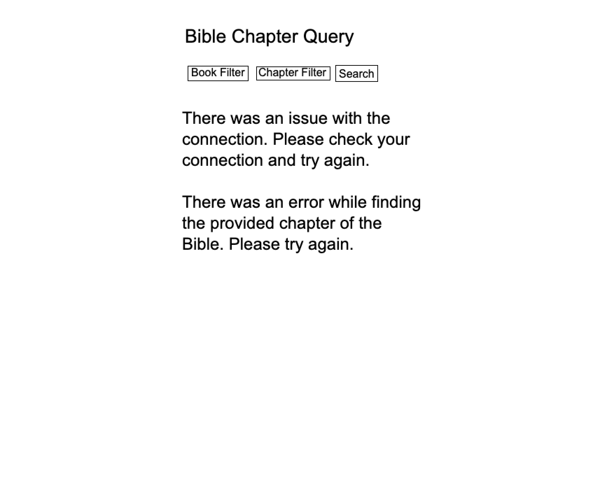

# Project Proposal: Bible Chapter Query

## Problem Statement

This app is for college students who read the Bible. Some college students want to read the Bible, but between homework, a job, and other commitments, finding time can be difficult. This app will provide a way to easily find a chapter of the Bible to read wherever a college student may be, without the need of dusting off a physical copy. 

## API

Endpoint: [https://rest.api.bible](https://rest.api.bible)

Example of a raw response: 

```
{
    "data":
    {
        "id":"GEN.1",
        "bibleId":"78a9f6124f344018-01",
        "number":"1",
        "bookId":"GEN",
        "reference":"Gen. 1",
        "copyright":"The Holy Bible, New International Version® NIV® Copyright © 1973, 1978, 1984, 2011 by Biblica, Inc.® Used by Permission of Biblica, Inc.® All rights reserved worldwide.",
        "verseCount":31,
        "content":"1\nThe Beginning\n     [1] In the beginning Go...ening, and there was morning—the sixth day.\n",
        "next":
        {
            "id":"GEN.2",
            "number":"2",
            "bookId":"GEN"
        },
        "previous":
        {
            "id":"GEN.intro",
            "number":"intro",
            "bookId":"GEN"
        }
        
    },
    "meta":
    {
        "fumsToken":"GzIBABwHbqxlyoOgvZ6CY0t9-baLdUQTCZKYJEtXX-isu-10UP5_-g7yrQVhEgSaUYIPsCSoUycRExM0-Wv6x_N2APSLmpzHu055WlaR1q-c94ZZGmpBD3fdagwVAfMzrDECkjf8sWbXWQBRAM5dknWgNYCvey9JafLImMpQQ1aumDFge5emP29LELJ2UuUFnxhG6NkS2QSOAqvn8f6qYTVd5Liqn3LJ-Vz6xCjzbOmlK_NVobdcZYMB"
    }
}
```

## Data Model

```
{
    reference: 'Gen. 1', 
    content: '1 The Beginning [1] In the beginning Go…ening, and there was morning—the sixth day.', 
    copyright: 'The Holy Bible, New International Version® …blica, Inc.® All rights reserved worldwide.', 
    next: 'GEN.2', 
    previous: 'GEN.intro'
}
```

Mappings from the raw response:
- reference: data.reference
- content: data.content
- copyright: data.copyright
- next: data.next.id
- previous: data.previous.id

## UI Sketches

Loaded:



Loading:



Errors:



## localStorage Plan

The user will be able to select the font size, font type, and light or dark mode. These settings will be stored in localStorage. The key will be named `'user-prefs'`. 

The data will look like this:
```
{
    mode: 'light',
    fontSize: 'medium',
    fontType: 'Helvetica'
}
```

## API Viability Check

- CORS/Browser Access: Accepts cross-origin requests.
- Rate Limits or Authentication: 5,000 requests per month.
- Attribution/Terms: Attribution is required in this format: [Bible translation abbreviation] © [Year] [Organization name.] All rights reserved. This link must also be on the page: https://api.bible
- Data Reliability: The data appears to be very reliable. It always comes in the same format and isn't likely to change.
